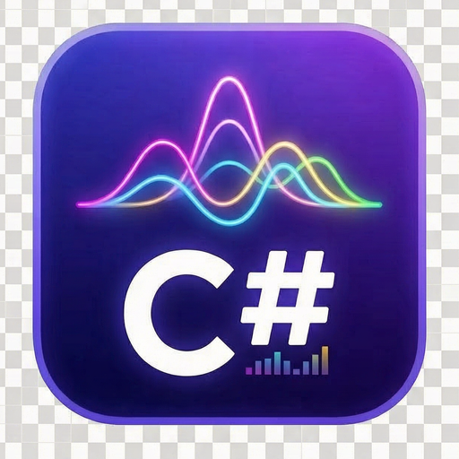
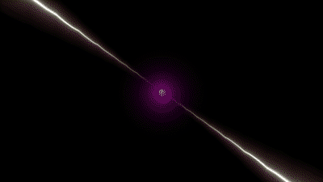
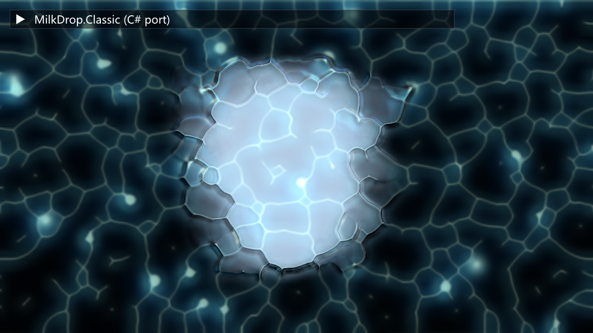
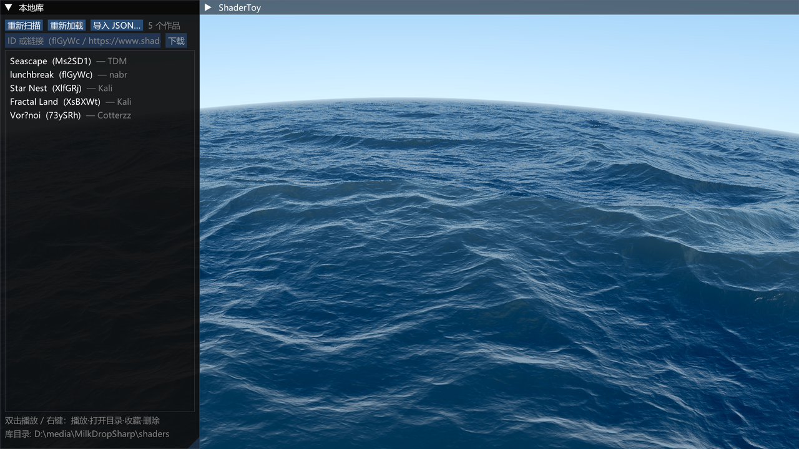
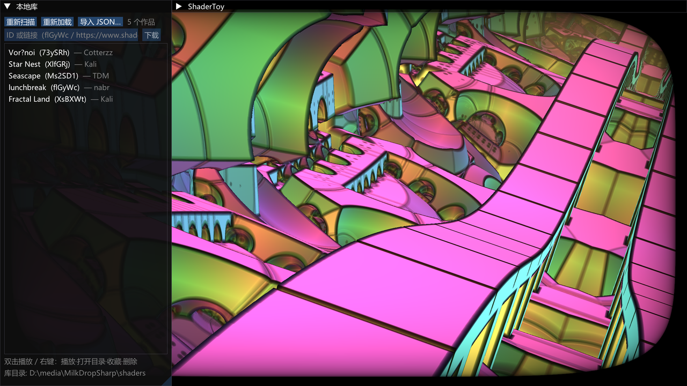

<div align="center">
  
  <h1>MilkDropSharp</h1>
  <p>两个 C++ 音乐可视化引擎的 .NET 托管移植：<b>projectM 4.1.8</b> 与 <b>MilkDrop3</b>（Windows x64）</p>
  <p><sub>AI「许愿式」生成 · 仅供学习与折腾，生产慎用</sub></p>
  <p><a href="README.md">English</a> · <b>简体中文</b></p>
</div>

---

> [!WARNING]
> **本项目是 AI「许愿式」生成的产物。**
>
> 绝大部分代码由大语言模型按自然语言描述（"把它移植过来""这里跑不动""加一个全屏"）直接生成，
> 人类只负责提需求、跑验收、指出哪里不对。因此：
>
> - 架构与代码风格是"能跑就对"的产物，**并非**按工业级标准设计，同一个模块里可能并存几套写法；
> - 除仓库里的单元测试与逐像素 A/B 对比之外**没有长期生产验证**，边界情况大概率没覆盖到；
> - 注释、文档、提交信息也多为 AI 生成，可能有过时或与代码不符之处（以代码为准）；
> - 把它当"可运行的参考实现 / 学习材料 / 折腾玩具"是合适的，**直接上生产请自己做充分评估与加固**。
>
> 移植正确性尽量用 9795 个真实预设 + 与原生 libprojectM 的截图对比来兜底，但覆盖不等于正确。

## 这是什么

仓库里有**两条互相独立的移植线**，共用两个基础库（表达式引擎、HLSL 转译器）：

| 移植线 | 对应上游 | 渲染 | 入口 |
|---|---|---|---|
| **Classic** | MilkDrop3（Milkdrop2 插件语义） | Direct3D 9（Vortice）+ HLSL 汇编着色器 | `src/MilkDrop.Classic.App` |
| **ProjectM** | libprojectM 4.1.8 + `frontend-sdl-cpp` | ANGLE → OpenGL ES 3.0（Silk.NET）+ HLSL→GLSL | `src/MilkDrop.ProjectM.App` |

两者都只跑在 **Windows x64**：Classic 依赖 D3D9，ProjectM 依赖 ANGLE 的 D3D11 后端，音频都走 WASAPI 环回。

共用的两个库是从 C++ 原样移植过来的，`Classic` 和 `ProjectM` 都直接使用：

- **`src/MilkDrop.Eval`** — `projectm-eval` 移植。ns-eel 表达式解释执行（`regNN` 槽、megabuf、gmegabuf、全套内建函数），**无 `Reflection.Emit`**，因此 Native AOT 安全。
- **`src/HlslParser`** — `hlslparser` 移植。把预设里的 HLSL 片段转成 GLSL（`Version330` / `Version300Es`），`tex2D`/`tex3D`/`register(...)` 都支持。

## 截图

<p align="center">
  
  
</p>

<p align="center">
  
  
</p>

<p align="center">
  
  
</p>

上排是 ProjectM 线（ANGLE/GLES3）的实时画面：`Serge + martin - crystal palace008` 与 `martin - neon space ps3`；
中排左是 `Geiss - Reaction Diffusion 2` 的静态帧，右是 Classic 线（D3D9）跑 `Flexi - crush ice 52s`；
下排是 ShaderToy 播放器，左边 `Seascape (Ms2SD1)`，右边 `Fractal Land (XsBXWt)`，整窗截图里能看到本地库面板。

## 下载

不想装 .NET SDK、也不想自己编译的话，这里有打包好的 **Windows x64 免安装版**（三个 App + 预设 + 纹理 + 示例 shader，解压即用）：

- 百度网盘：<https://pan.baidu.com/s/1QTe2AXRftQvoQH7nxpUiMA?pwd=gbj7>
- 提取码：`gbj7`

解压后直接双击需要的那一个 exe；ProjectM 版默认读同级目录的 `presets/` 与 `textures/`。

## 状态

| 部分 | 状态 | 验证方式 |
|---|---|---|
| `MilkDrop.Eval` | 完成 | 98 个测试（`tests/MilkDrop.Eval.Tests`） |
| `HlslParser` | 完成 | 65 个测试 + `tests/golden` 里的 hlsl/glsl 对照用例 |
| `MilkDrop.ProjectM` + App | 完成（P0–P10） | 9795 个预设全部跑通（加载失败 67 个，均为预设自身语法损坏）；126 个测试；AOT 产物与 JIT 版截图平均差 0.89/255 |
| `MilkDrop.Classic.*` | 完成 | 187 个测试（`tests/MilkDrop.Classic.Tests`） |

表中的"完成"指**按移植计划逐项跑通验收**（计划见 [`projectMPlan.md`](projectMPlan.md)），不代表代码质量、边界覆盖或性能达到生产标准——原因见上方声明。

ProjectM 线与原生 `libprojectM` 做过逐帧耗时对比和 A/B 截图，数据见 [`projectMMisc.md`](projectMMisc.md)。

## 环境要求

- Windows 10/11 **x64**
- [.NET 10 SDK](https://dotnet.microsoft.com/download)（`Directory.Build.props` 里 `TargetFramework=net10.0`；`HlslParser` 单独用 `net9.0`）
- 显卡需支持 **D3D11**（ANGLE 后端）与 **D3D9**（Classic）
- 只有做 Native AOT 时才需要 **VS 2022 Build Tools + "使用 C++ 的桌面开发"**（要有 `link.exe`）

## 快速开始

### ProjectM（GLES3 版）

```powershell
# 直接跑（预设目录必须显式给，或用 exe 旁的 presets 兜底）
dotnet run --project src\MilkDrop.ProjectM.App -c Release -- ^
  --preset-dir "res\projectMSDL-2.0.0-win64\presets\presets-cream-of-the-crop"
```

预设查找顺序：

1. `--preset <文件>` 单个 `.milk`
2. `--playlist <文件>`（每行一个路径，`#` 开头为注释）
3. `--preset-dir <目录>`（**可重复，递归**扫描 `.milk`）
4. 都没有时，退回到 **exe 同级的 `presets\` 目录**

纹理同理：`--texture-dir` 可重复，否则用 exe 旁的 `textures\`。

常用参数：

```powershell
--width N --height N        窗口尺寸（默认 1024x768）
--fullscreen               启动即全屏（运行中 F11 切换）
--no-ui                    不建 ImGui 界面（纯画面，跑分用）
--novsync                  关闭垂直同步
--shuffle                  随机播放
--duration SEC --blend SEC 单预设时长（默认 30）/ 软切时长（默认 3）
--no-audio                 不采集系统音频（静音驱动）
--synthetic-audio          用合成测试音（有节拍，批量验证用）
--preset-dir DIR           见上
--smoke N                  渲染 N 帧后自动退出
--shot FILE                退出前存一张 PNG
--auto-next N              每 N 帧自动切下一个预设
--fixed-dt S               固定时间步长（可复现截图对比）
--bench [--bench-frames N] 批量跑全部预设并出 CSV 报告
```

完整列表：`--help`。

### Classic（D3D9 版）

```powershell
dotnet run --project src\MilkDrop.Classic.App -c Release -- --preset random
```

资源目录不需要配：程序会从当前目录向上找含 `res\MilkDrop3\plugins\Milkdrop2\data\include.fx` 的仓库根。
找不到时用环境变量指定：

```powershell
$env:MILKDROP_CLASSIC_ROOT = "F:\path\to\MilkDropSharp"
```

常用参数：

```powershell
--width N --height N       窗口尺寸（默认 1280x720）
--preset <名字|路径|random>
--preset-duration SEC      自动换预设的平均间隔（默认 16，另有 0..10 秒随机抖动）
--blend SEC                交叉时长（默认自动 2.7 / 手动 1.7；0 = 硬切）
--lock-preset              锁定当前预设
--audio loopback|none      音频来源（默认 WASAPI 环回）
--sprite <名字> [--sprite-code <EEL>]   挂一个 sprite 及其 init 代码
--shader-compat            打开着色器兼容层（宏名遮蔽 / double / 非有限字面量 / get_fft / ps_2_0 指令槽升级）
--reference                用 D3D9 reference 设备（软件光栅，调试用）
--smoke [秒]               跑指定秒数后退出（默认 3）
--shot FILE --shot-delay S 定时截图
--ui-scale F                UI 缩放（默认按 DPI 推断）
```

### 快捷键

| ProjectM | | Classic | |
|---|---|---|---|
| `Space` | 暂停/继续 | `N` / `P` | 下一个 / 上一个 |
| `N` / `→` | 下一个 | `Space` | 随机 |
| `P` / `←` | 上一个 | `L` | 锁定当前预设 |
| `R` | 随机 | | |
| `L` | 锁定当前预设 | | |
| `S` | 截图 | | |
| `F` | 显示/隐藏界面 | | |
| `F11` | 全屏 / 窗口 | | |
| `H` | 帮助 | | |
| `Esc` / `Q` | 退出 | | |

## Native AOT 发布

两个 App 都能提前编译成不依赖 .NET 运行时的单 exe（原生库仍需随行）。

### ProjectM

AOT 属性是**条件式**的，日常 `dotnet build` 不受影响，只有显式传 `-p:PublishAot=true` 才启用：

```powershell
# 建议先清空输出目录，避免旧产物混进来（“发布包里没带 dll”最常见的原因）
Remove-Item -Recurse -Force artifacts\p10\aot -ErrorAction SilentlyContinue

dotnet publish src\MilkDrop.ProjectM.App -c Release -r win-x64 -p:PublishAot=true -o artifacts\p10\aot
Remove-Item artifacts\p10\aot\*.pdb
```

产物（约 11 MB）：

```
MilkDrop.ProjectM.App.exe   4.5 MB   真 AOT 本机代码
av_libglesv2.dll            5.1 MB   ANGLE（GLES3 → D3D11）
cimgui.dll                  1.2 MB   Dear ImGui 原生绑定
glfw3.dll                   0.2 MB   窗口 / 输入
```

冷启动 0.46s（JIT 版 0.71s）。**已知限制**：NAudio 的 WASAPI 在 AOT 下不可用（`MMDeviceEnumeratorComObject..ctor()` 编译成必定抛异常的桩），音频自动降级为静音，画面照常渲染；需要声音时用 JIT 版或 `--synthetic-audio`。

### Classic

`MilkDrop.Classic.App.csproj` 里已经打开 `PublishAot` 与 `RuntimeIdentifiers=win-x64`，直接发布即可：

```powershell
dotnet publish src\MilkDrop.Classic.App -c Release -r win-x64
```

## 测试

```powershell
dotnet test MilkDrop.ProjectM.sln      # ProjectM + Eval 线
dotnet test MilkDrop.Classic.sln       # Classic + Eval 线
dotnet test HlslParser.sln             # HLSL 转译器（含 golden 文件对照）
```

部分渲染测试会建**离屏 GL 上下文（32×24）**并真实执行着色器，所以需要一块能跑 GLES3 的显卡，纯 CI 无显卡环境不适用。

## 资源与语料

仓库里的 `res/` 只用于运行与回归测试，不属于源码：

| 路径 | 内容 |
|---|---|
| `res/projectMSDL-2.0.0-win64/` | projectM 官方 Windows 发行版：**9795 个 `.milk`**（`presets/presets-cream-of-the-crop`）、66 张纹理；其中的 `projectMSDL.exe` / `projectM-4.dll` 是 A/B 对比的“标尺” |
| `res/MilkDrop3/plugins/Milkdrop2/` | MilkDrop3 插件资源：477 个预设、129 张纹理、31 个 `.shape`、19 个 `.wave`、82 张 sprite、`data/include.fx` |

## 性能概览

C# 版（Release JIT，ANGLE/GLES3）与原生 libprojectM 4 的逐帧耗时对比，mesh 32×24、静音、无 UI、关 vsync，单位 ms/帧：

| 分辨率 | 原生（无同步） | C#（`--smoke`，真实循环） |
|---|---|---|
| 640×480 | 1.55 | 3.73（268 FPS） |
| 1280×720 | 1.48–1.54 | 3.65（274 FPS） |
| 1920×1080 | 1.47–1.51 | 3.70（270 FPS） |

几点实测结论：

- 耗时基本与分辨率无关，**瓶颈在 CPU 侧**（每帧几十次 GL 状态切换 + 逐顶点 EEL 求值）。
- 少数预设会慢得多，原因是**自定义形状实例数**（例如 3584 个 shape 实例/帧 → 单帧 17 ms），不是填充率问题。
- 高分辨率下（如 2560×1600 全屏）会转为**填充率瓶颈**：warp shader 每像素多次纹理采样，约 66 FPS。

完整数据、测量脚本说明与加载耗时对比见 [`projectMMisc.md`](projectMMisc.md)。

## 仓库结构

```
src/
  MilkDrop.Eval/              projectm-eval 移植（EEL 解释器、megabuf）
  HlslParser/                 hlslparser 移植（HLSL → GLSL 330 / 300es）
  MilkDrop.Classic.Render.D3D9/   D3D9 后端（Vortice、HLSL 汇编、ImGui DX9）
  MilkDrop.Classic.Visualizer/    MilkDrop3 预设语义（Visualizer/PresetState/WarpMesh/Sprite…）
  MilkDrop.Classic.App/           命令行 + 窗口 + UI
  MilkDrop.ProjectM/          libprojectM 移植（Renderer/MilkdropPreset/Audio…）
  MilkDrop.ProjectM.App/          命令行 + 窗口 + UI
tests/
  MilkDrop.Eval.Tests/  HlslParser.Tests/  MilkDrop.Classic.Tests/  MilkDrop.ProjectM.Tests/
  golden/                     HLSL→GLSL 的输入/期望输出对照
res/                          预设、纹理、上游发行版（见上）
MilkDrop.ProjectM.sln  MilkDrop.Classic.sln  HlslParser.sln
```

## 文档

| 文件 | 内容 |
|---|---|
| [`projectMPlan.md`](projectMPlan.md) | ProjectM 移植计划：目标、C++→C# 代码映射表、P0–P10 阶段拆分与验收 |
| [`projectMIssue.md`](projectMIssue.md) | 踩坑记录（ANGLE x64/EGL 入口、MRT、着色器转译、AOT…），按阶段编号 |
| [`projectMMisc.md`](projectMMisc.md) | 性能实测、语义笔记、测量脚本用法、待办 |

## 已知限制

- **仅 Windows x64**。Classic 绑死 D3D9；ProjectM 绑死 ANGLE 的 D3D11 后端与 WASAPI 环回。
- ProjectM 线**不包含** projectM 的 C API 层、`ProjectMCWrapper`、SDL 前端；预设里的 user sprite 与歌曲标题动画未移植。
- **ANGLE 用的是 Avalonia 构建的 `av_libglesv2.dll`**（真 x64，EGL 入口带 `EGL_` 前缀）。Silk.NET 自带的 ANGLE 原生包在 `runtimes/win-x64` 下是 x86 二进制，放到 x64 进程会 `BadImageFormatException`。
- **AOT 版 ProjectM 无音频**（NAudio WASAPI 的 COM 类在 ILC 下无有效 IL），自动静音降级。
- `--fullscreen` 时以显示器当前模式为准，`--width/--height` 不生效。
- 9795 个预设里有 67 个（0.68%）加载失败，原因都是预设文件自身的语法/寄存器错误，与移植无关。

## 许可证

本仓库以 **GPL-3.0** 发布，见 [`LICENSE`](LICENSE)。

移植自 [projectM](https://github.com/projectM-visualizer/projectm)（4.1.8）与 [MilkDrop3](https://github.com/MilkDrop2077/MilkDrop3)，上游项目各自的许可证与版权声明同样适用；分发时请一并遵守。
